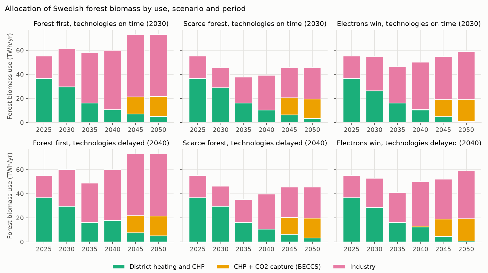
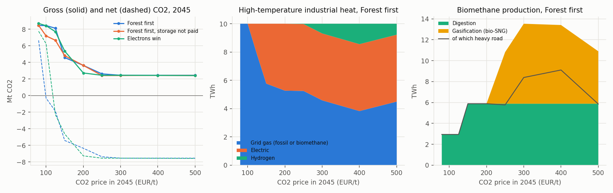
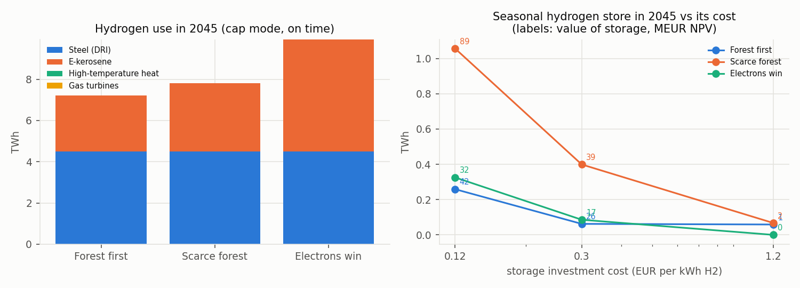
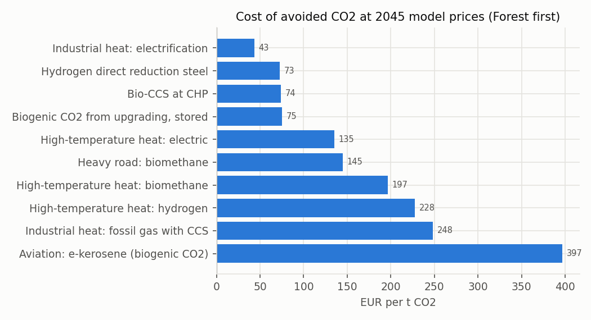
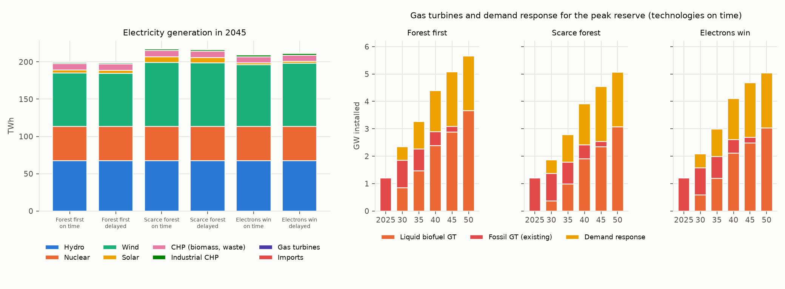
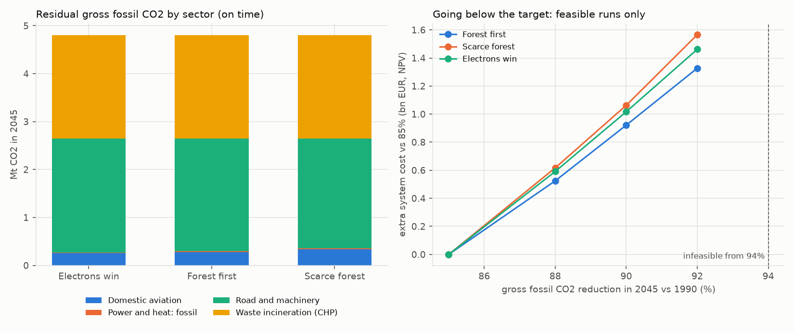

# sweden-biomass-times-mini

A self-directed exercise to learn the TIMES model architecture before a PhD in this field. It is a small linear optimisation model of the Swedish energy system in GAMS whose sets, parameters and equations follow TIMES naming. It is **not TIMES** and does not use the TIMES source code. **All data are illustrative**, so the results are relative insights only; every number has a source and a verification status in [`data/sources.csv`](data/sources.csv).

## Question

How should Sweden allocate its limited forest biomass between turbine fuels (aviation and peak gas turbines), district heating, industry, biomethane and BECCS on the way to net zero in 2045, and how does the answer depend on biomass availability and on when new conversion technologies arrive? Version 0.2 adds hydrogen with seasonal storage, biogas and biomethane, high-temperature industrial heat, a CO2 price mode and a biogenic carbon debt.

## Three numbers (illustrative data)

1. **14 TWh** of forest biomass goes to CHP plants with CO2 capture in 2045 in all six runs, also with 30% less biomass. The amount is set by the net-zero constraint: stored CO2 has to balance the residual fossil emissions (5.2 Mt in 2045).
2. **6.1 bn EUR** (NPV 2025-2054, 4%) is the extra system cost of scarce biomass, against **0.4 to 0.8 bn EUR** for a ten-year delay of new conversion technologies.
3. **About 85 EUR per MWh stored** is the cost of one seasonal cycle in a lined rock cavern hydrogen store at 1.2 EUR/kWh, more than twice the winter premium of hydrogen in the model (about 35 EUR/MWh). Seasonal hydrogen storage is therefore worth only 0 to 2 MEUR here: hydro reservoirs already do the seasonal balancing.



## Version 0.2: hydrogen, biomethane and industrial decarbonisation

Results: [`results/tables/hydrogen_biomethane.md`](results/tables/hydrogen_biomethane.md), `python scripts/hydrogen_biomethane.py`.

**What was added.** Anaerobic digestion with upgrading on three feedstock steps (10 TWh in total) and gasification to bio-SNG. Biomethane goes to heavy road transport or into the gas grid, where a guarantee-of-origin constraint allocates it to gas users without CO2 capture. The pure CO2 stream from upgrading can be liquefied for storage or e-kerosene. Hydrogen is balanced by season, with a lined rock cavern store cycling over the four seasons. High-temperature industrial heat (10 TWh: cement, lime, reheating) is a separate demand met by grid gas, hydrogen or electric heating (plasma, induction; build rate limited). A CO2 price mode replaces the cap with a price path, with or without payment for stored biogenic CO2, and a carbon debt option counts a share of the CO2 in additional forest biomass as an emission.

**Findings (illustrative).**

- **Hydrogen goes to steel and e-kerosene, not to heat.** Hydrogen demand in 2045 is 7.2 to 9.9 TWh (steel 4.5 TWh, the rest e-kerosene for the ReFuelEU synthetic quota) with 0.9 to 1.3 GW of electrolysis. Hydrogen for high-temperature heat appears only in price mode: 4 to 5 TWh from 200 EUR/t with cheap electrolysis (Electrons win), at most 1.4 TWh with base costs.
- **Seasonal hydrogen storage has little value in a hydro system.** Electrolysers run flat across the seasons and the store stays below 0.1 TWh. Only at a tenth of the assumed cost (0.12 EUR/kWh, below salt-cavern level) does it grow to 0.3 to 1.1 TWh, worth 32 to 89 MEUR. The nine time slices do not resolve weekly wind lulls, so short and medium-duration storage is not assessed.
- **Biomethane is a transport fuel first.** Digestion supplies 2.3 TWh in 2025 (Swedish statistics: about 2.3 TWh of biogas in 2023), all for heavy road transport, and about 6 TWh at higher CO2 prices. Bio-SNG from forest biomass enters only at about 250 EUR/t, and only then does biomethane reach the gas grid and high-temperature heat.
- **Cost of avoided CO2 at 2045 model prices:** electrification of industrial heat 43, hydrogen steel 73, bio-CCS at CHP 74, storing the CO2 from biogas upgrading 75, electric high-temperature heat 135, biomethane in trucks 145, biomethane for high-temperature heat 197, hydrogen for high-temperature heat 228, fossil gas with CCS 248 and e-kerosene 397 EUR/t.
- **Paying for negative emissions changes the path, not the floor.** In price mode, CO2 storage reaches its 10 Mt limit from 125 EUR/t when stored CO2 is paid. Gross fossil CO2 falls to a floor of 2.4 Mt (waste incineration and domestic aviation) at 250 to 300 EUR/t, with or without payment.
- **A carbon debt shifts biomass to capture.** If 30% of the CO2 in additional forest biomass counts as an emission, forest biomass use falls from 73 to 60 TWh (Forest first) while CHP with capture rises from 14 to 22 TWh and stored CO2 from 5.2 to 8.1 Mt (+1.5 bn EUR). At 60% only sawmill by-products are used and the extra cost is 1.4 to 2.0 bn EUR across the scenarios.







## What the model shows on biomass (illustrative)

- When biomass is scarce, industrial heat from biomass (52 to 25 TWh) and district heating without capture give way, while biomass with CO2 capture stays.
- Bio-jet and renewable diesel come from black liquor and lipids rather than from solid forest biomass, and the SAF share follows the ReFuelEU minimum (42% in 2045).
- The peak grows from 26.7 to 30.3 GW by 2045 and is met with 2.3 to 2.9 GW of liquid-biofuel gas turbines plus 2 GW of demand response.



## Residual emissions: by sector, by innovation gap and below the target

The 2045 gross cap binds in every run, so the residual is always 5.2 Mt; what changes is its make-up and what it costs to go further ([`results/tables/residuals.md`](results/tables/residuals.md), `python scripts/residuals.py`).

- **By sector:** 2.2 Mt from fossil waste in incineration CHP, 1.2 to 2.0 Mt from high-temperature industrial heat, 0.7 to 1.5 Mt from road and machinery diesel and 0.3 Mt from domestic aviation. Low-temperature industrial heat and steel are fully decarbonised by 2045.
- **Innovation gaps** (Forest first, one technology group unavailable): without hydrogen steel (DRI) the cap can only be met by leaving steel demand unserved; without advanced biofuels the system costs 0.9 bn EUR more and the CO2 price rises from 145 to 222 EUR/t; without biomethane +0.3 bn EUR (168 EUR/t); without bio-CCS at CHP storage falls to 4.7 Mt (+0.3 bn EUR). Without e-kerosene the model has no solution even before the CO2 cap, because the ReFuelEU synthetic-fuel quota cannot be met.
- **Below the target:** going from 85% to 92% gross reduction costs 1.5 to 1.9 bn EUR. From 94% there is no feasible solution under the cap in any scenario: the 2.2 Mt from waste incineration has no capture option in the model, so CCS at waste-to-energy plants is the innovation that the deeper cut depends on.



## Scenarios

| Parameter | Forest first | Scarce forest | Electrons win |
|---|---|---|---|
| Forest biomass supply from 2030 | x1.2 | x0.7 | x1.0 |
| Aviation fuel demand growth | 1%/yr | 2%/yr | 1%/yr |
| Electrolysis / wind investment cost | x1.0 / x1.0 | x1.0 / x1.0 | x0.6 / x0.8 |
| Synthetic aviation fuel sub-quota | x1 | x1 | x2 |

Each scenario is crossed with a technology-timing axis, following Sandberg and Krook-Riekkola (2022): gasification-FT, black liquor gasification, bio-SNG, BECCS and e-kerosene are available from 2030 or from 2040. Sensitivities: discount rate 2% and 7%, and domestic aviation CO2 weighted x2. Version 0.2 adds CO2 price runs (80 to 500 EUR/t in 2045), carbon debt shares of 0.3 and 0.6, and runs without hydrogen storage or with cheaper storage.

## Model structure

48 processes (power, CHP, district heating, industry, steel, biorefineries, biomethane, hydrogen and its storage, e-kerosene, CO2 storage), periods 2025 to 2050 in 5-year steps and 9 time slices (4 seasons x day/night plus a 100-hour winter peak); hydrogen is balanced by season. Gross fossil CO2 follows Sweden's 85% target applied to the model scope, with net zero from 2045; aviation follows the ReFuelEU Aviation quotas. 2025 is calibrated to SCB statistics (total electricity +0.7%).

| Equation | Meaning | TIMES counterpart |
|---|---|---|
| `EQ_OBJ` | NPV of investment, O&M, resources and (price mode) CO2, minus salvage | `EQ_OBJ` |
| `EQ_CPT` | capacity = residual + vintages in lifetime | `EQE_CPT` |
| `EQ_CAPACT` | activity <= capacity x availability | `EQL_CAPACT` |
| `EQ_COMBAL` | commodity balance per slice or year | `EQG_COMBAL` |
| `EQ_H2BAL`, `EQ_H2STG` | hydrogen balance by season, cyclic storage level | `EQG_COMBAL` at season level, `EQ_STGTSS` |
| `EQ_ACTFLO`, `EQL/EQG_OUTSHR` | refinery output split between bio-jet and diesel | `EQ_ACTFLO`, `EQ_OUTSHR` with `FLO_SHAR` |
| `EQ_PEAK` | firm capacity >= peak x (1 + margin) | `EQ_PEAK` with `NCAP_PKCNT`, `COM_PKRSV` |
| `EQ_CO2GROSS`, `EQ_CO2NET`, `EQ_SAF` | climate target and aviation quotas | `COM_BNDNET`, user constraints |
| `EQ_BMGGO` | biomethane credit only against gas use without capture | user constraint |

Names were checked against the open-source TIMES code (TIMES 4.7.3). [`times_extension/`](times_extension/) adds a gasification-FT process to the open-source TIMES demo model as a data file.

More: [data, assumptions, calibration and limitations](docs/assumptions.md), [changelog](CHANGELOG.md), [value of information](results/tables/voi.md) (upper bound on the EVPI of knowing biomass availability before 2040: 33 MEUR, 0.02% of system cost).

## How to run

GAMS (classic syntax, GAMS 45 or newer; about 1,900 equations and 1,950 variables, so the demo licence is enough) and Python 3.10+ with pandas and matplotlib.

```bash
gams model/core.gms --SCN=forest_first --TIMING=ontime   # one run
gams model/core.gms --CO2P=200 --NEGCR=0                 # CO2 price mode, stored CO2 not paid
python scripts/run_all.py     # 6 core runs + 9 sensitivities -> results/csv/
python scripts/plots.py       # figures and tables
python scripts/voi.py         # value of information
python scripts/residuals.py   # residual emissions: sectors, innovation gaps, frontier
python scripts/hydrogen_biomethane.py   # v0.2: H2 storage, abatement curve, carbon debt, cost of avoided CO2
python scripts/to_iamc.py     # IAMC-format export and protocol checks (needs pyam-iamc)
```

## Scenario data in IAMC format

[`results/iamc/`](results/iamc/) holds all 15 runs as one IAMC-format table (model, scenario, region, variable, unit, year), written with [pyam](https://pyam-iamc.readthedocs.io/), with common IAMC names where they exist (`Emissions|CO2|Energy and Industrial Processes`, `Carbon Sequestration|CCS|Biomass`, `Secondary Energy|Electricity|Wind|Onshore`, `Price|Carbon`) and model-specific names for the forest biomass allocation. The script checks completeness, totals against their components, the gross cap, net zero from 2045 and the 2025 calibration: [`results/iamc/checks.md`](results/iamc/checks.md).

## References

- Sandberg, E. and Krook-Riekkola, A. (2022). The impact of technology availability on the transition to net-zero industry in Sweden. *Journal of Cleaner Production* 363, 132594.
- Krook-Riekkola, A., Wetterlund, E. and Sandberg, E. (2017). *Biomassa, systemmodeller och målkonflikter*. Energiforsk rapport 2017:407.
- Papadias, D.D. and Ahluwalia, R.K. (2021). Bulk storage of hydrogen. *International Journal of Hydrogen Energy* 46, 34527. doi:10.1016/j.ijhydene.2021.08.028
- Energigas Sverige, biogas production statistics (about 2.3 TWh of biogas in 2023, 2.4 TWh in 2024).
- Regulation (EU) 2023/2405 (ReFuelEU Aviation), Annex I.
- Svenska kraftnät (2024). Långsiktig marknadsanalys 2024.
- Further sources: [`data/sources.csv`](data/sources.csv) and [`docs/assumptions.md`](docs/assumptions.md).

Author: Mikhail Serikov, 2026.
