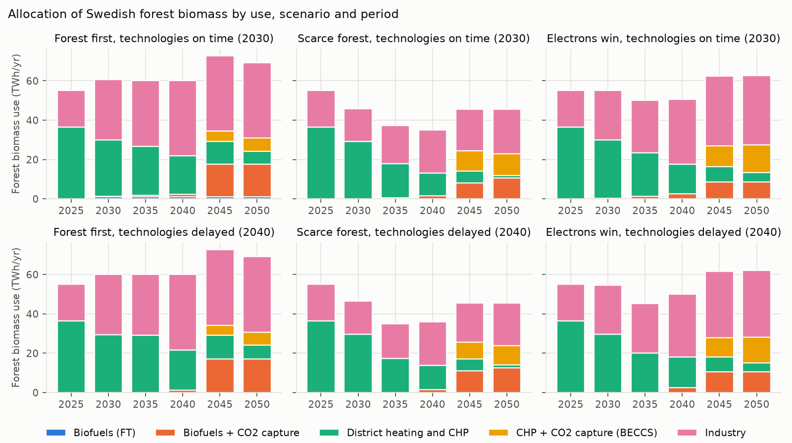
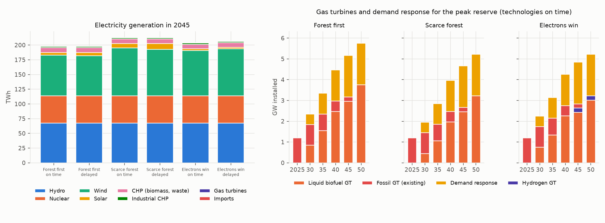
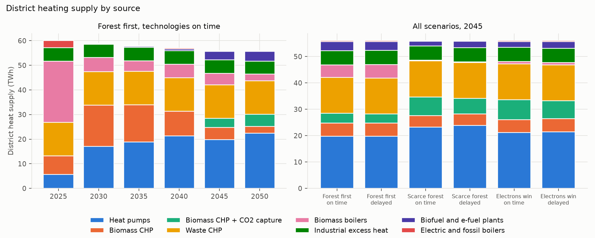
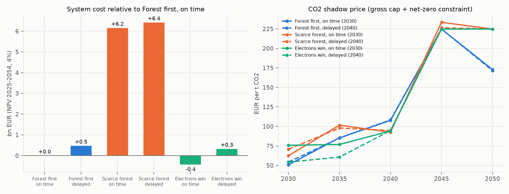

# sweden-biomass-times-mini

A TIMES-inspired linear optimisation model of the Swedish energy system in GAMS, built on the TIMES model architecture (sets, parameters, variables and equations follow TIMES naming). It is **not TIMES**, does not use the TIMES source code and is far smaller than TIMES-Sweden. **All data are illustrative**; every number has a source and a verification status in [`data/sources.csv`](data/sources.csv).

## Question

How should Sweden allocate its limited forest biomass between turbine fuels (aviation and peak gas turbines), district heating, industry and BECCS on the way to net zero in 2045? How does the answer depend on biomass availability, on when new conversion technologies become available and on competition with e-fuels, hydrogen and electrification?

## Three numbers (illustrative data)

1. **15 to 16 TWh** of forest biomass goes to CHP plants with CO2 capture in 2045 in all six runs, also when biomass is 30% scarcer. The amount is set by the net-zero constraint: stored biogenic CO2 must balance the residual fossil emissions allowed under the gross cap (4.8 Mt in 2045 in every run). The uses that shrink when biomass is scarce are industrial heat (47 to 28 TWh) and district heating without capture (6 to 3 TWh).
2. **6.0 bn EUR** (NPV 2025-2054, 4%) is the extra system cost of the Scarce forest scenario compared with Forest first, against **0.3 to 0.8 bn EUR** for delaying gasification, black liquor gasification, BECCS and e-kerosene from 2030 to 2040.
3. **At most 6 MEUR** is the expected value of knowing biomass availability before 2040 (upper bound on EVPI, below 0.01% of system cost): the investments of the 2030s hardly depend on it. The largest difference between the perfect-information plans is 0.5 GW of onshore wind.





## Policy-relevant insights

- **Biomass for negative emissions is the robust use.** When forest biomass becomes scarce, the model keeps biomass in CHP plants with CO2 capture and moves low-temperature heat to heat pumps and industrial heat to electrification. Industrial heat is the largest flexible biomass user, so the industry transition and the biomass budget have to be planned together.
- **Liquid biofuels come from black liquor and lipids, not from solid forest biomass.** In the six core runs, black liquor gasification and HEFA supply the bio-jet and renewable diesel, and gasification-FT of forest biomass is hardly used (at most 0.3 TWh of biomass in 2045). The refineries run close to diesel mode: renewable diesel replaces fossil diesel, whose CO2 counts fully in the domestic target, while only 18% of jet fuel CO2 does (the rest is international aviation). Gasification-FT with capture returns at a 2% discount rate (5 to 19 TWh of biomass in 2045). The result depends on how the FT naphtha cut is valued (fossil naphtha parity here).
- **Aviation follows the ReFuelEU quota.** The SAF share is 42% in 2045 in Forest first and Scarce forest, exactly the ReFuelEU minimum, and 47% in Electrons win, where the doubled synthetic sub-quota adds e-kerosene.
- **A few GW of new peak capacity, mostly liquid-biofuel gas turbines.** The peak grows from 26.7 GW (2025) to 30.3 GW (2045). The model builds 2.5 to 3.0 GW of gas turbines on liquid biofuel by 2045 together with 2 GW of demand response; the turbines run at most about 70 hours a year and in Electrons win serve only as reserve. Hydrogen turbines appear only in Electrons win (0.2 to 0.3 GW) and at a 2% discount rate (0.8 to 1.9 GW). This is the same order of magnitude as the about 3.7 GW of gas turbines reported for the EF scenario of Svenska kraftnät's long-term market analysis 2024 (LMA 2024).

The 2045 CO2 shadow price is 140 to 210 EUR/t in the core runs. It reflects the assumed costs and the scope of the target, not a forecast.

## Scenarios: narratives translated into parameters

**Forest first.** Forest biomass is easier to mobilise than today (more logging residues, stumps and low-grade wood), new conversion technologies arrive on schedule and aviation grows moderately.

**Scarce forest.** Material use of wood and biodiversity protection reduce the biomass available for energy by 30%, aviation grows strongly and BECCS remains allowed.

**Electrons win.** Biomass stays at today's level, electrolysis and wind become much cheaper and the EU raises the demand for e-fuels (synthetic aviation fuel sub-quota doubled).

| Parameter | Forest first | Scarce forest | Electrons win |
|---|---|---|---|
| Forest biomass supply from 2030 (`BIO_MULT`) | x1.2 | x0.7 | x1.0 |
| Aviation fuel demand growth (`AVI_G`) | 1%/yr | 2%/yr | 1%/yr |
| Electrolysis investment cost (`ELZ_MULT`) | x1.0 | x1.0 | x0.6 |
| Wind investment cost (`WIND_MULT`) | x1.0 | x1.0 | x0.8 |
| Synthetic aviation fuel sub-quota (`SYN_MULT`) | x1 | x1 | x2 (capped at the SAF quota) |

Each narrative is crossed with a **technology-timing axis**, following the idea of Sandberg and Krook-Riekkola (2022): gasification-FT (with and without capture), black liquor gasification, BECCS at CHP and pulp mills and e-kerosene are available from 2030 (on time) or 2040 (delayed). 3 x 2 = 6 runs. Sensitivities: discount rate 2% and 7%, and a factor of 2 on domestic aviation CO2 (non-CO2 effects).

## Model structure

**Reference energy system.** Forest biomass (4-step supply curve), black liquor (tied to pulp production), waste, lipid feedstock, fossil fuels and limited biofuel imports feed 39 processes: hydro, nuclear, onshore and offshore wind, solar, interconnector imports, demand response, biomass CHP with and without CO2 capture, waste CHP, gas turbines on liquid biofuel, hydrogen and fossil fuel, heat-only boilers, large heat pumps, electric boilers, industrial excess heat, electrolysis, HEFA, gasification-FT (outputs bio-jet, renewable diesel, naphtha and heat to district heating), black liquor gasification, e-kerosene from H2 and captured biogenic CO2, industrial heat options (black liquor recovery boilers with and without capture, biomass, electrification, fossil with and without CCS), blast furnace and hydrogen direct reduction steel, export of bio-naphtha and CO2 storage. Demands: electricity (including net exports), district heat, industrial process heat, steel, road and machinery diesel and aviation fuel.

**Refinery products.** HEFA, gasification-FT and black liquor gasification produce a distillate group (bio-jet plus renewable diesel) with a fixed yield per unit of activity. Within the group, each plant chooses the split between jet mode and diesel mode inside bounds (TIMES: `FLO_SHAR` on a commodity group). Gasification-FT also yields a fixed 25% naphtha cut, which is sold to the petrochemical market at fossil naphtha parity through an export process (TIMES: `IRE_PRICE`).

**Time.** Periods 2025 (calibration), 2030, ..., 2050 of 5 years; 4 seasons x day/night + a 100-hour winter peak = 9 time slices. Electricity and heat are balanced per slice; fuels, hydrogen and CO2 per year. Today's electricity demand keeps a winter-peaking load shape; demand growth after 2025 is spread evenly over the slices. Hydropower has an annual energy budget, a seasonal limit and a minimum flow. Electric boilers are switched off in the winter peak from 2030, and demand response can only be used in that slice.

**Climate target.** Gross domestic fossil CO2 in the model scope falls linearly to (1 - 0.85)/(1 - 0.33) of the 2025 model level by 2045, which applies Sweden's 85% reduction target (relative to 1990, with emissions 33% below 1990 in 2024) proportionally to the model scope. From 2045 net emissions (gross minus stored biogenic CO2) must be at most zero. International aviation is reported as a memo item and is regulated through the ReFuelEU Aviation quotas instead.

### Equations and their TIMES counterparts

| Equation in `model/core.gms` | Meaning | TIMES counterpart |
|---|---|---|
| `EQ_OBJ` | NPV of investment minus salvage value, fixed and variable O&M, resources, minus export revenue | `EQ_OBJ` with `EQ_OBJINV`, `EQ_OBJFIX`, `EQ_OBJVAR`, `EQ_OBJSALV` |
| `EQ_CPT` | capacity = residual capacity + vintages within technical lifetime | `EQE_CPT` (`eqcpt.mod`) |
| `EQ_ACTFLO` | distillate group output = yield x activity | `EQ_ACTFLO` |
| `EQL_OUTSHR`, `EQG_OUTSHR` | bio-jet and renewable diesel shares within the distillate group | `EQ_OUTSHR` with `FLO_SHAR` (`UP`, `LO`) |
| `EQ_CAPACT` | activity <= capacity x availability x slice length | `EQL_CAPACT` (`eqcapact.mod`) |
| `EQ_COMBAL` | production + supply >= consumption + demand, per slice or year | `EQG_COMBAL` (`eqcombal.mod`) |
| `EQ_MUSTUSE` | all supplied waste is incinerated | bound on commodity net (`COM_BNDNET`) |
| `EQ_CO2CAP` | captured biogenic CO2 = storage (BECCS) + CCU (e-kerosene) | `EQE_COMBAL` for that commodity |
| `EQ_HYDAFA`, `EQ_HYDSEAS` | hydro annual and seasonal energy | `NCAP_AFA` and `NCAP_AFS` at `SEASON` level |
| `EQ_EMIS` | CO2, NOx and PM2.5 accounting | `FLO_EMIS` on `ACT` (process) and `VDA_EMCB` (fuel) |
| `EQ_CO2GROSS`, `EQ_CO2NET` | gross cap and net zero from 2045 | `COM_BNDNET` on the emission commodity or a user constraint |
| `EQ_SAF`, `EQ_SYN` | ReFuelEU minimum SAF and synthetic shares | user constraints (`UC_ACT`) |
| `EQ_PEAK` | firm capacity (including demand response) >= peak load x (1 + margin) | `EQ_PEAK` with `NCAP_PKCNT`, `COM_PKRSV` |
| variable bounds | supply steps, technology start year, growth limit per period, electric boilers off at peak | `ACT_BND`, `NCAP_START`, `NCAP_BND` |

Equation and parameter names were checked against the open-source TIMES code (TIMES 4.7.3, [etsap-TIMES](https://github.com/etsap-TIMES)). Parameters carry TIMES names (`PRC_ACTFLO`, `FLO_SHAR`, `NCAP_COST`, `NCAP_FOM`, `ACT_COST`, `NCAP_TLIFE`, `NCAP_AFS`, `NCAP_AFA`, `NCAP_BND`, `NCAP_START`, `NCAP_PKCNT`, `COM_PKRSV`, `PRC_CAPACT`, `PRC_RESID`, `COM_PROJ`, `COM_FR`, `G_YRFR`, `G_DRATE`, `FLO_EMIS`, `VDA_EMCB`, `IRE_PRICE`), but without the region and data-year indices that TIMES uses.

As a first step towards the real TIMES code, [`times_extension/`](times_extension/) adds a Swedish-type gasification-FT process (jet and diesel from biomass) to the open-source TIMES demo model as a data file, without changing the TIMES source.

Differences from TIMES, stated plainly: input and output shares are fixed except the bio-jet/renewable diesel split of the refineries, so flows are expressed through `VAR_ACT` and `PRC_ACTFLO`, and `VAR_FLO` is used only for that distillate group; processes operate either at slice level or at annual level (`PRC_TS`); there is no trade between regions apart from a fixed electricity export, capped imports and the naphtha export, no elastic demand and no storage process (hydrogen is balanced annually, with a storage cost added to hydrogen turbines).

## Data and assumptions

Levels: **verified** (checked against the primary source), **approximate** (order of magnitude from a named source, or a derived value) and **assumption** (modelling choice, documented). Full list with sources: [`data/sources.csv`](data/sources.csv).

| Parameter | Value | Source | Level |
|---|---|---|---|
| ReFuelEU minimum SAF and synthetic shares (`SAF_SHR`, `SYN_SHR`) | SAF 2/6/20/34/42/70%; synthetic 1.2/5/10/15/35% (2025-2050) | Regulation (EU) 2023/2405, Annex I | verified |
| Calibration statistics, electricity 2025 | 167.9 TWh (hydro 68.1, nuclear 44.8, wind 39.0) | SCB, Electricity supply 2025 (preliminary) | verified |
| National emissions 2024 relative to 1990 (`RED_2025`) | -33% | Naturvårdsverket, preliminary 2024 statistics | verified |
| 2045 target (`RED_2045`) | -85% vs 1990, applied proportionally to the model scope | Swedish climate policy framework | approximate |
| Jet fuel uplifted in Sweden 2025 (`COM_PROJ` AVF) | 8.5 TWh | EIA jet fuel consumption 2023 (14.4 thousand bbl/day, about 8.1 TWh); Naturvårdsverket international aviation 1.8 Mt CO2e in 2024 (about 7 TWh) plus domestic | approximate |
| Domestic share of jet fuel CO2 (`DOM_SHR`) | 18% | ratio of domestic to international aviation in the Swedish inventory | assumption |
| District heat demand (`COM_PROJ` HET) | 60 TWh in 2025, slowly declining | SCB 2023 (60.5 TWh) | approximate |
| Electricity demand excluding endogenous uses (`COM_PROJ` ELC) | 130 TWh (2025) to 168 TWh (2050) | informed by Energimyndigheten long-term scenarios | assumption |
| Load shape and peak (`G_YRFR`, `COM_FR`) | 9 slices, 100-hour winter peak; peak 26.7 GW (2025), 30.3 GW (2045); growth spread evenly | peak/average about 1.8 for today's demand | assumption |
| Peak contribution (`NCAP_PKCNT`) | hydro 0.82 (13.4 GW), nuclear 0.90, wind 0.09, imports 0.75 of 4 GW | Swedish winter power balance practice (order of magnitude) | assumption |
| Peak reserve margin (`COM_PKRSV`) | 5% (about 1.5 GW) | Svenska kraftnät LMA 2024: 1.8 to 3.6 GW frequency restoration reserves needed in 2045 | approximate |
| Demand response at peak (`DR_ELC`) | up to 0.5 GW new per period from 2030 (2 GW in 2045), 300 EUR/MWh activation | Ei: industrial flexibility capability about 1,700 MW (cited by Jernkontoret); Svenska kraftnät LMA 2024 on flexibility | approximate |
| Electric boilers in the winter peak | off from 2030 | interruptible loads | assumption |
| Forest biomass supply curve (`RES_VOL`, `RES_COST`) | 30/20/15/15 TWh at 15/22/30/42 EUR/MWh | stepwise supply curve | assumption |
| Black liquor, waste, lipid feedstock | 42 / 18 / 8 TWh | constant pulp production; waste must be treated; share of a constrained lipid market | approximate / assumption |
| FT product slate (`PRC_ACTFLO`, `FLO_SHAR`) | per TWh liquids: 0.25 naphtha, 0.15 to 0.55 bio-jet, rest renewable diesel | Kreutz et al. (2008): about 39% gasoline/naphtha in a diesel-gasoline configuration | approximate / assumption |
| HEFA and black liquor gasification jet share of distillates (`FLO_SHAR`) | 10-50% and 20-60% | plants switch between renewable diesel and jet mode | assumption |
| Bio-naphtha export price (`IRE_PRICE`) | 45 EUR/MWh | fossil naphtha parity | assumption |
| Fossil fuel prices | gas 35, jet 55, diesel 60, coal 15 EUR/MWh | constant prices, no separate carbon tax | assumption |
| Technology costs and efficiencies | see `data/processes.csv`, `data/flows.csv` | Danish Energy Agency Technology Data, JRC, IEA (orders of magnitude) | approximate |
| Emission factors | CO2: IPCC 2006 defaults; NOx and PM2.5: EMEP/EEA Guidebook Tier 1 | IPCC 2006; EMEP/EEA 2023 | approximate |
| CO2 storage capacity (`STG_MAX`) | 2/5/8/10/10 Mt/yr (2030-2050) | informed by SOU 2020:4 | assumption |
| Discount rate (`G_DRATE`) | 4% (sensitivity 2% and 7%) | project choice | assumption |

## Calibration

| Item | Statistics (TWh) | Model 2025 (TWh) | Difference |
|---|---|---|---|
| Hydropower | 68.1 | 67.5 | -0.8% |
| Nuclear | 44.8 | 46.1 | +2.9% |
| Wind | 39.0 | 41.3 | +5.9% |
| Solar | 4.4 | 4.3 | -1.8% |
| Conventional thermal | 11.6 | 9.8 | -15.6% |
| Total electricity production | 167.9 | 169.0 | +0.7% |
| District heating supply | 60.5 | 60.0 | -0.8% |

Electricity: SCB, Electricity supply 2025 (preliminary). District heating: SCB 2023. The 2025 peak load in the model is 26.7 GW. Built-in checks run after every solve: no unserved demand, no negative costs, no process producing more energy than it consumes (heat pumps and industrial electrification excluded), all balances satisfied.

## Co-benefits: stationary NOx and PM2.5 (model scope)

| Scenario | NOx 2025 (kt) | NOx 2045 (kt) | PM2.5 2025 (kt) | PM2.5 2045 (kt) |
|---|---|---|---|---|
| Forest first, on time | 33.1 | 32.6 | 6.1 | 5.7 |
| Scarce forest, on time | 33.1 | 26.0 | 6.1 | 4.2 |
| Electrons win, on time | 33.1 | 29.9 | 6.1 | 5.3 |

Less biomass combustion lowers NOx and PM2.5; liquid-fuel gas turbines have high NOx factors per unit of fuel but run few hours. Factors are Tier 1 orders of magnitude (EMEP/EEA Guidebook) and cover stationary combustion only. Full table: [`results/tables/co_benefits.md`](results/tables/co_benefits.md).

## Value of information

Simplified analogue of the stochastic mode of TIMES ([`scripts/voi.py`](scripts/voi.py)): biomass availability is the same until 2035 and revealed in 2040 (x1.2, x1.0 or x0.7, probability 1/3 each). The expected-value plan (EV) fixes all investments up to 2035 and is re-solved in each state (EEV); the wait-and-see solutions (WS) know the state in advance. EEV - WS = 6 MEUR is an upper bound on EVPI. The first-stage decisions hardly differ across states; the largest difference is onshore wind (0.5 GW), followed by industrial electrification (0.3 GW). The full two-stage recourse problem (RP, and VSS = EEV - RP) exceeds the GAMS demo licence used for development and is left for a run with a full licence. Results: [`results/tables/voi.md`](results/tables/voi.md).

More figures:





## How to run

Requirements: GAMS (developed with GAMS 54.5, written in classic syntax for GAMS 45 or newer) and Python 3.10+ with pandas and matplotlib. The full model has about 1,720 equations and 1,730 variables, so it also solves under the GAMS demo licence.

```bash
gams model/core.gms --SCN=forest_first --TIMING=ontime   # one run, writes results/forest_first_ontime.gdx
python scripts/run_all.py     # 6 core runs + 9 sensitivity runs -> results/csv/
python scripts/plots.py       # figures and tables -> results/figures/, results/tables/
python scripts/voi.py         # value of information -> results/tables/voi.md
```

The Python scripts find GAMS through the `GAMS_SYSDIR` environment variable, the `gamspy_base` package or `gams` on the PATH, and read GDX files with `gams.transfer` (for GAMS 45: `pip install "gamsapi[transfer]==45.*"`; or `pip install gamspy`, which bundles a GAMS system).

```
model/core.gms        sets, data, variables, equations, solve (TIMES names)
model/report.gms      reporting and model checks
scenarios/*.gms       scenario narratives as parameter values
data/*.csv            processes, flows, output shares, trade, time slices, demand, resources, policy
data/sources.csv      source and verification status of every number
scripts/              run_all.py, plots.py, voi.py, gdxio.py
results/              figures, tables and CSV results
```

## Known limitations and next steps

Limitations:

- **Illustrative data.** Costs, efficiencies and supply curves are orders of magnitude, not a calibrated national data set; the model answers relative questions about allocation and trade-offs and does not forecast the Swedish energy system.
- **One region and little trade.** Electricity exports are fixed, imports are capped at 4 GW, bio-naphtha is the only exported fuel and there is no trade in bio-jet or renewable diesel. Surplus SAF could in reality be sold to other EU markets under ReFuelEU.
- **Simplified time slices.** Nine slices with a 100-hour winter peak; the assumption that demand growth after 2025 is flat across slices lowers the 2045 peak by about 3 GW compared with scaling today's load shape. There is no storage process.
- **Peak capacity depends on the demand-response potential.** Demand response reaches its upper bound (2 GW) in every run, so each additional GW of flexibility would replace roughly one GW of gas turbines.
- **Aviation non-CO2 effects are not modelled.** Only a sensitivity with domestic aviation CO2 weighted x2 is included. NOx and PM2.5 are tracked as co-benefits of stationary combustion only.
- **Other simplifications.** Perfect foresight within each scenario, exogenous demands, no land-use or forest carbon accounting (biomass is treated as carbon neutral at combustion) and a CO2 target applied proportionally to the model scope.

Next steps:

- Contrail and NOx-at-altitude effects of aviation by fuel type (fossil jet, bio-jet, e-kerosene), so that the SAF choice also reflects non-CO2 climate effects.
- Sensitivities on the value of the FT naphtha cut and on the demand-response potential, which drive the gasification-FT and gas turbine results.
- Soft-linking with a spatially explicit model of biofuel supply chains (plant locations, feedstock transport, heat sinks) and with a CGE model, in the spirit of the EMEC and TIMES-Sweden linkage (Krook-Riekkola et al. 2017).
- The full two-stage stochastic recourse problem (RP and VSS) and uncertainty in technology timing as a second stochastic dimension.
- Running the same question on the open-source TIMES code with a reduced TIMES-Sweden data set.

## Model revisions

**11 October 2026.** Two results of the first version were implausible and are corrected:

| Result (2045) | First version | Revised |
|---|---|---|
| SAF share of jet fuel (Forest first / Scarce forest / Electrons win, on time) | 98% / 52% / 77% | 42% / 42% / 47% |
| New and existing peak gas turbines (on time) | 8.6 / 8.0 / 8.1 GW, fuel switching between liquid biofuel and hydrogen | 3.2 / 2.7 / 2.8 GW, mostly liquid biofuel |
| Forest biomass to plants with CO2 capture (six runs) | 18 to 22 TWh (CHP and gasification-FT) | 15 to 16 TWh (CHP) |
| Extra cost of Scarce forest vs Forest first | 6.2 bn EUR | 6.0 bn EUR |
| Upper bound on EVPI | 37 MEUR | 6 MEUR |
| Calibration, total electricity 2025 | +0.7% | +0.7% |

Causes and fixes: refinery products were produced in fixed shares, so bio-jet was a forced co-product of renewable diesel and negative emissions; the jet fuel demand was annualised from one low-season month; all electricity demand growth inherited today's winter-peaking load shape; electric boilers ran in the winter peak on electricity from gas turbines; and demand flexibility could not contribute to the peak. See the commit history for each change.

## References

- Sandberg, E. and Krook-Riekkola, A. (2022). The impact of technology availability on the transition to net-zero industry in Sweden. *Journal of Cleaner Production* 363, 132594. doi:10.1016/j.jclepro.2022.132594
- Krook-Riekkola, A., Wetterlund, E. and Sandberg, E. (2017). *Biomassa, systemmodeller och målkonflikter*. Energiforsk rapport 2017:407.
- Krook-Riekkola, A., Berg, C., Ahlgren, E. O. and Söderholm, P. (2017). Challenges in top-down and bottom-up soft-linking: Lessons from linking a Swedish energy system model with a CGE model. *Energy* 141, 803-817.
- Kreutz, T. G., Larson, E. D., Liu, G. and Williams, R. H. (2008). Fischer-Tropsch fuels from coal and biomass. 25th Annual International Pittsburgh Coal Conference.
- Regulation (EU) 2023/2405 (ReFuelEU Aviation), Annex I.
- SCB: Electricity supply 2025 (preliminary); district heating supply by type of plant 2023.
- Naturvårdsverket: preliminary greenhouse gas statistics for 2024 (June 2025); emissions from international aviation 2024.
- Svenska kraftnät (2024). Långsiktig marknadsanalys 2024 (LMA 2024).
- Energimarknadsinspektionen, as cited in Jernkontoret report D 870: flexibility capability of Swedish industry.
- U.S. Energy Information Administration: jet fuel consumption, Sweden, 2023.
- Danish Energy Agency: Technology Data catalogues; EMEP/EEA Air Pollutant Emission Inventory Guidebook; IPCC 2006 Guidelines (emission factors).

Author: Mikhail Serikov, 2026.
